# Pawchan 0.1.53

Android-клиент для 2ch с чтением 4chan и Архивача. Поддерживаются Android 11 и новее, архитектура ARM64.
Код версии Android (`versionCode`): **54**.

<table>
  <tr>
    <td align="center">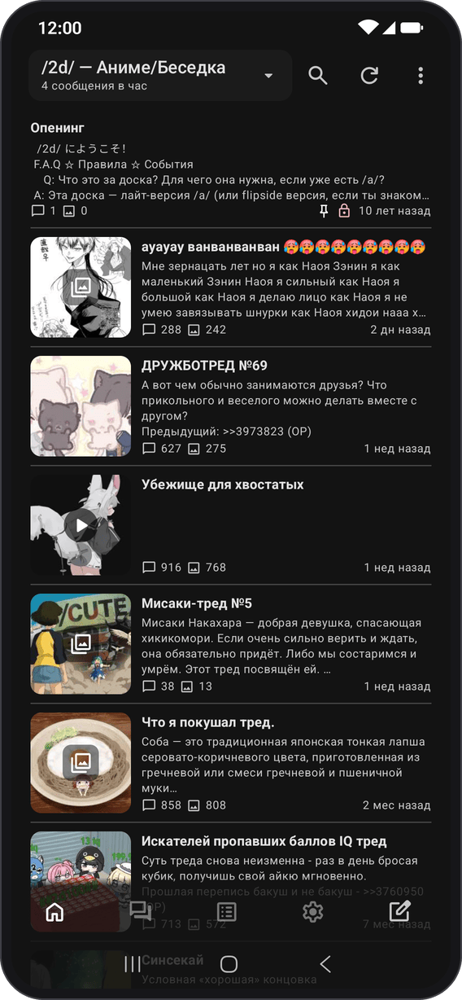 Доска</td>
    <td align="center">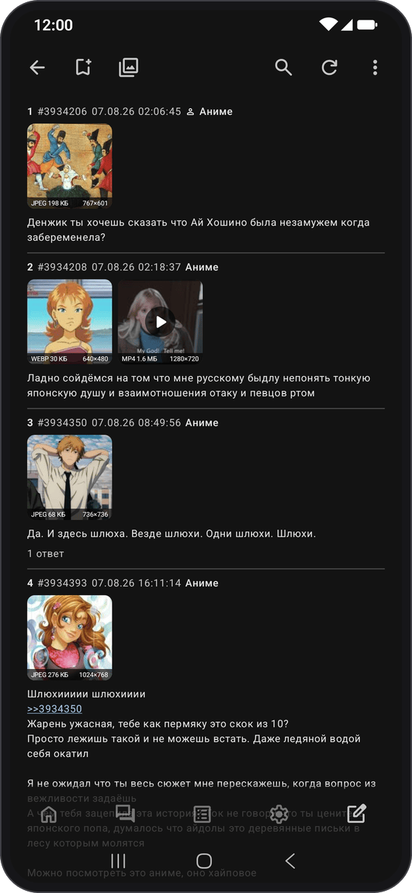 Тред</td>
    <td align="center">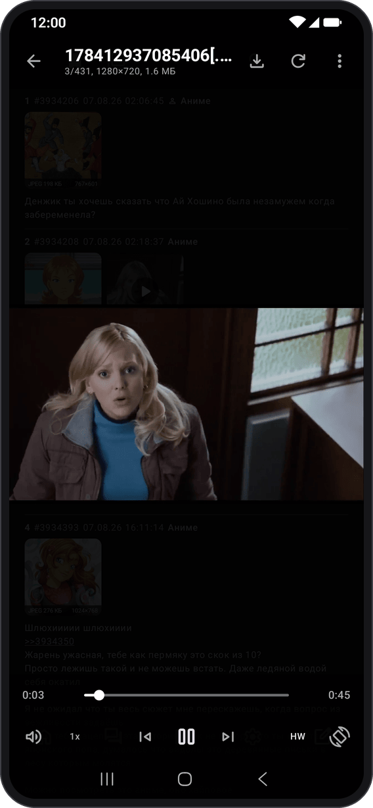 Видео на libmpv</td>
  </tr>
  <tr>
    <td align="center">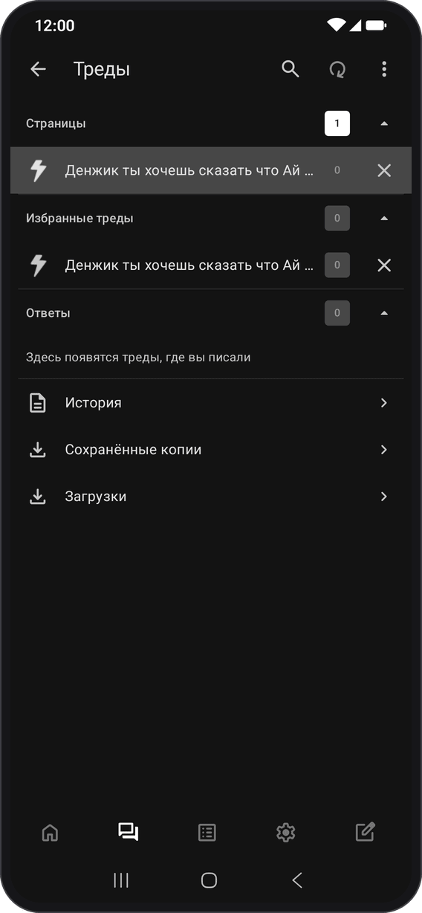 Треды и избранное</td>
    <td align="center">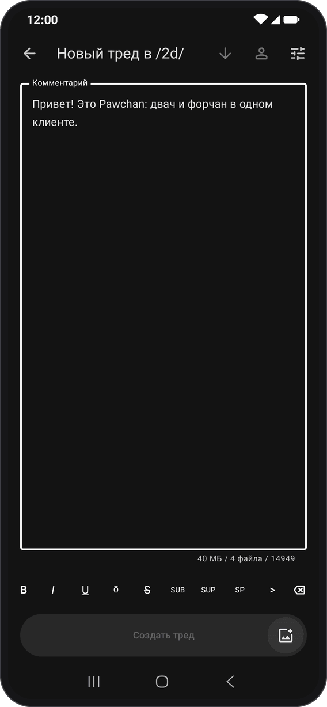 Новый пост</td>
    <td align="center">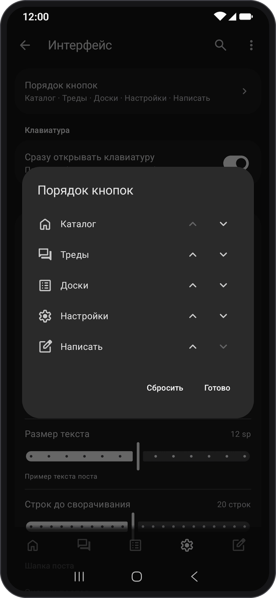 Порядок кнопок панели</td>
  </tr>
</table>

## В движении

<table>
  <tr>
    <td align="center">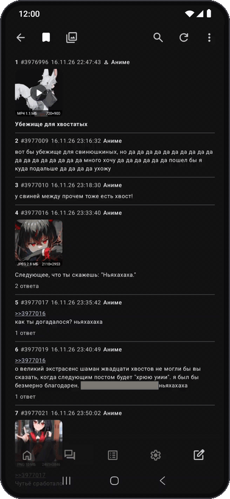 Листание файлов и закрытие свайпом</td>
    <td align="center">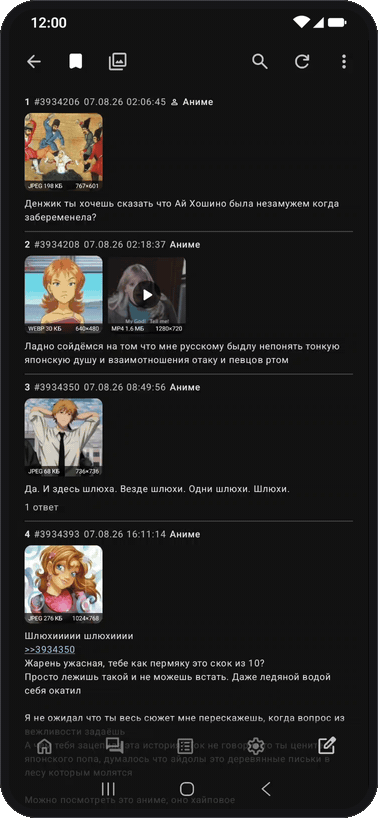 Тредшот: выделил посты, сохранил картинку</td>
    <td align="center">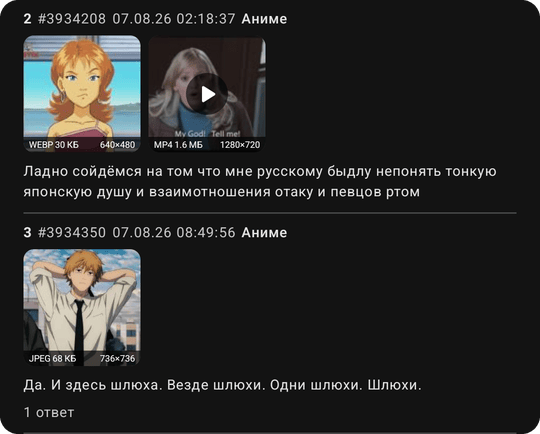 Готовый тредшот</td>
  </tr>
</table>

## Что умеет

- **2ch и 4chan**: доски, треды и поиск; на 2ch можно писать, 4chan и Архивач открываются для чтения, тред можно сохранить в Архивач.
- **Просмотр файлов**: листание свайпом, закрытие жестом, загрузка в выбранную папку.
- **Видео на libmpv**: скорость, аппаратное декодирование, картинка в картинке.
- **Тредшот**: выделенные посты сохраняются одной картинкой, пиксель в пиксель как на экране.
- **Раздел «Треды»**: открытые страницы, избранное, ответы, история, сохранённые копии и загрузки.
- **Нижняя панель** с настраиваемым порядком кнопок.
- **Автоскрытие** постов и тредов по своим правилам.
- **Сеть**: свои прокси SOCKS5, HTTP и HTTPS для каждого ресурса, управление куками.
- **Приватность**: блокировка PIN-кодом или биометрией, резервные копии с паролем.
- **Оформление**: системная, светлая, тёмная и AMOLED-тема, 10 языков интерфейса.
- **Обновления** прямо из приложения.

Ещё скриншоты

 
<table>
  <tr>
    <td align="center">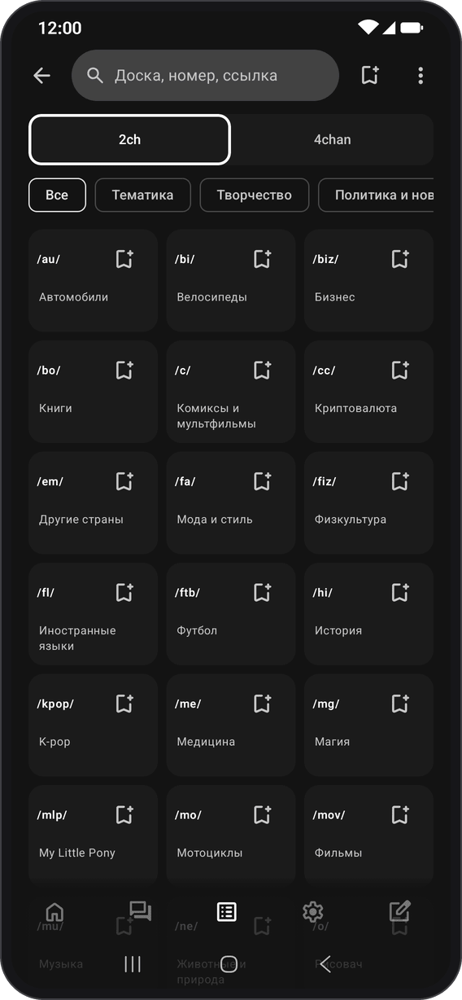 Список досок</td>
    <td align="center">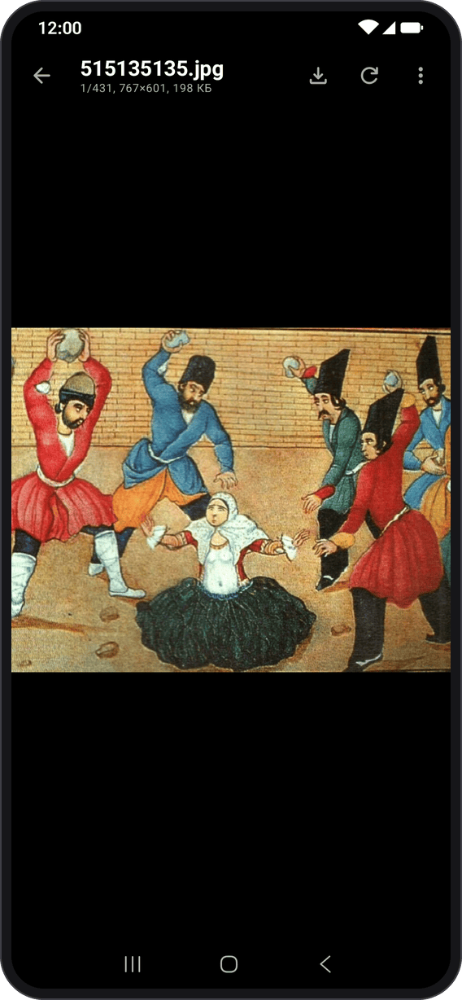 Просмотрщик</td>
    <td align="center">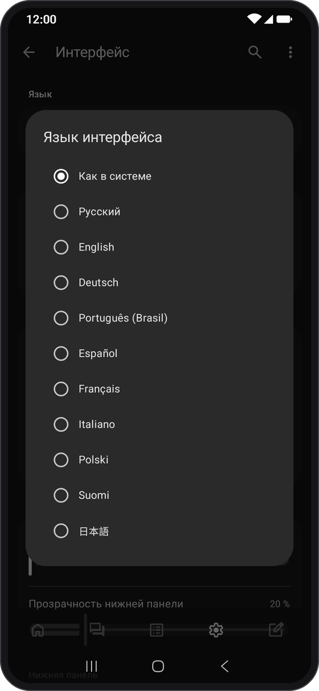 Язык интерфейса</td>
  </tr>
</table>

## Установка

Подписанные APK публикуются в [релизах GitHub](https://github.com/Solthariel/Pawchan/releases).
Требования к установке и обновлению описаны в [руководстве](docs/INSTALL.md).

## Сборка из исходников

Откройте в Android Studio папку, в которой лежит `settings.gradle.kts`.
Для сборки нужны JDK 25, Android SDK Platform 37, NDK 29.0.14206865 и CMake 3.22.1.
[Среда разработки и команды проверки](docs/DEVELOPMENT.md).

## Документация

- [Что нового в приложении](app/src/main/assets/settings-changelog.txt)
- [Как работает автоскрытие](docs/AUTOHIDE.md)
- [Настройка прокси](PROXY-README-RU.txt)
- [Карта проекта и документация](docs/README.md)
- [Подготовка и публикация релиза](docs/RELEASE_PROCESS.md)
- [Как сняты скриншоты](scripts/readme-shots.ps1)
